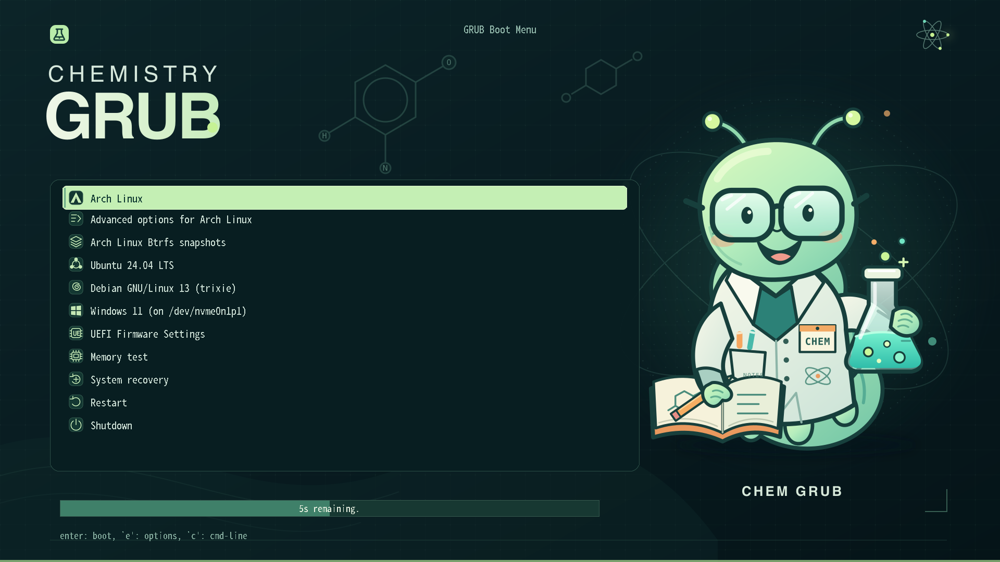

# Chemistry GRUB

[](https://github.com/wszqkzqk/chem-grub/actions/workflows/ci.yml)
[](LICENSE)

A chemistry-inspired GRUB2 theme featuring **Chem Grub**, an original grub
scientist with safety goggles, a lab coat, and a bubbling flask.



[简体中文说明](README.zh-CN.md) · [Contributing](CONTRIBUTING.md) ·
[Validation guide](docs/VALIDATION.md)

## Features

- **Original artwork:** editable SVG mascot and a midnight laboratory backdrop.
- **Native GRUB localization:** the default GRUB title, `@KEYMAP_SHORT@`, and
  `@TIMEOUT_NOTIFICATION_MIDDLE@` use GRUB's translations. The interface follows
  GRUB's `$lang` and falls back to English when a translation is unavailable.
  Boot-entry names remain controlled by the operating system and its generators.
- **CJK-ready fonts:** two PF2 sizes of Noto Sans Mono CJK SC, each containing
  44,810 glyphs. Latin half-width and CJK full-width advances are checked during
  the build. The fonts also cover Japanese, Korean, and other common scripts.
- **Complex menus:** nested Arch advanced options and grub-btrfs snapshot menus
  use the same responsive list, with seven visible rows at 720p and eleven at
  1080p, plus scrolling for longer lists.
- **Complete resources:** 76 class icons, selection and menu nine-slice images,
  timeout styling, and a bilingual-capable terminal font.
- **Reproducible packaging:** source artwork, bundled font licenses, previews,
  CI, and a zip-building Makefile target.

The theme does not modify Arch or grub-btrfs generator scripts.

## Installation

### From a packaged theme

Download `chem-grub.zip` from a [CI build](https://github.com/wszqkzqk/chem-grub/actions), extract it, and run:

```sh
sudo ./chem-grub/install.sh
```

The installer detects `/boot/grub` or `/boot/grub2`, copies the theme, backs up
`/etc/default/grub` and the existing generated configuration, enables the
theme, and regenerates GRUB's configuration. Existing boot entries are left
unchanged.

Useful options:

```sh
./chem-grub/install.sh --dry-run
./chem-grub/install.sh --copy-only
./chem-grub/install.sh --help
```

### From source

Install Python 3, GNU Make, `rsvg-convert` (provided by librsvg), and the Python
requirements, then run:

```sh
python3 -m pip install -r requirements.txt
make
sudo sh scripts/install.sh
```

`make` creates both `dist/chem-grub/` and `dist/chem-grub.zip`.

### Arch Linux package

The repository includes an Arch `PKGBUILD` and an Arch Linux CI job. To build a
package locally:

```sh
cd archlinux
makepkg --syncdeps --cleanbuild
sudo pacman -U ./chem-grub-*.pkg.tar.zst
sudo /boot/grub/themes/chem-grub/install.sh
```

The package only installs files; enabling the theme remains a separate,
explicit step. See [archlinux/README.md](archlinux/README.md) for details.

To configure an already copied theme manually, set this in `/etc/default/grub`
and regenerate the configuration using your distribution's command:

```sh
GRUB_THEME="/boot/grub/themes/chem-grub/theme.txt"
```

For example, on Arch Linux:

```sh
sudo grub-mkconfig -o /boot/grub/grub.cfg
```

Do not force `GRUB_TERMINAL_OUTPUT=console`; the graphical terminal is required
for the theme.

## Development and verification

```sh
make          # Build the theme, previews, and zip archive
make check    # Build and run all static validation
make docs     # Refresh the reference images in docs/images/
make clean    # Remove generated files
```

Build requirements are Python 3, Pillow, fontTools, and `rsvg-convert`.
`make check` validates resources, PF2 data, font widths, localization templates,
and representative long entries. It is **not** a replacement for booting GRUB.
See [the validation guide](docs/VALIDATION.md) for a QEMU test that does not
require a real operating system installation.

## Project layout

```text
artwork/             Original mascot SVG
src/                 Background, theme, fonts, and preview translations
scripts/             Build and installation scripts
archlinux/           Arch Linux PKGBUILD and packaging notes
docs/                Community documentation and reference images
.github/             CI and contribution templates
dist/                Generated theme and zip (not committed)
```

## Community

Bug reports and pull requests are welcome. Please read
[CONTRIBUTING.md](CONTRIBUTING.md) and the
[Code of Conduct](CODE_OF_CONDUCT.md). Development history is recorded in
[commit messages](https://github.com/wszqkzqk/chem-grub/commits/main).

## License and credits

Project code and original artwork are available under the
[GNU General Public License v2 or later (GPL-2.0-or-later)](LICENSE).
Copyright (C) 2026 Zhou Qiankang <wszqkzqk@qq.com>. Bundled fonts use the SIL Open Font License; see
[NOTICE](NOTICE) and the license files in `src/fonts/`.
